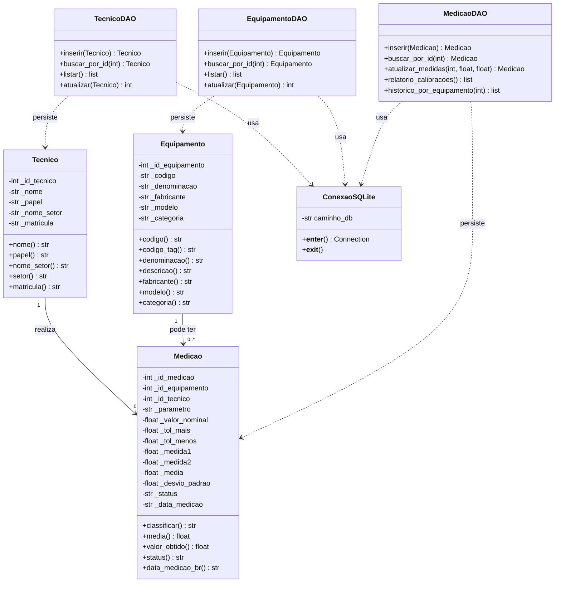

# 06 — Documentação Técnica do MVP (Parte 1)

**Unidade Curricular:** Projeto Aplicado I
**Empresa parceira:** Schulz S.A.
**Docentes:** Prof. MSc. Hugo Menezes Barra | Prof. Rodrigo Losina
**Equipe:** Marx Braga Camilo, Gladson Goulart, Carla Tayna, Yorman Hernandez
**Entrega:** AV03 — Construção do MVP (Parte 1)
**Data:** 03 de novembro de 2026

---

## 1. Apresentação

Este documento descreve a implementação da Parte 1 do MVP do sistema de gestão de calibrações da Schulz S.A., desenvolvida em **Programação Orientada a Objetos com Python** e conectada ao banco de dados relacional **SQLite**.

A entrega dá continuidade direta às etapas anteriores. A AV01 levantou o processo manual de emissão de certificados de calibração, seus requisitos funcionais e suas regras de negócio. A AV02 modelou o banco relacional em três tabelas — `tecnico`, `equipamento` e `medicao` — e entregou o script DDL `03_banco.sql`, já validado no SQLite.

Esta etapa avança da modelagem para o código. O script DDL e o script de execução da AV02 foram **reaproveitados sem qualquer alteração estrutural**, garantindo continuidade entre as entregas e preservando as restrições de integridade já validadas. Sobre essa base foram acrescentados:

| Arquivo | Conteúdo |
|---|---|
| `04_classes.py` | Classes de domínio (`Tecnico`, `Equipamento`, `Medicao`), classe de conexão (`ConexaoSQLite`) e objetos de acesso a dados (DAOs) |
| `05_main.py` | Classe principal de demonstração: instanciação, INSERT, UPDATE, SELECT com JOIN e relatório no terminal |
| `06_mvp_parte1.md` | Este documento |

---

## 2. Arquitetura da solução

### 2.1 Camadas e responsabilidades

O projeto foi organizado em três camadas com responsabilidades delimitadas, atendendo simultaneamente ao requisito de **encapsulamento** e ao requisito de **separação de responsabilidades** previstos no roteiro.

**Camada de domínio** — classes `Tecnico`, `Equipamento` e `Medicao`. Concentram os atributos, as validações e as regras de negócio metrológicas. Todos os atributos são privados (prefixo `_`) e acessados por propriedades somente leitura. A validação ocorre no construtor, de modo que um objeto nunca existe em estado inválido.

**Camada de persistência** — classe `ConexaoSQLite` e as classes `TecnicoDAO`, `EquipamentoDAO` e `MedicaoDAO`. Concentram exclusivamente o acesso ao SQLite: abertura e fechamento de conexão, comandos SQL e tradução de erros.

**Camada de apresentação** — classe principal em `05_main.py`. Orquestra os objetos, executa as operações e formata o relatório de calibração no terminal.

### 2.2 Estrutura do repositório

```text
projeto-aplicado-1/
├── 03_banco.sql          # DDL das tabelas (AV02 — reaproveitado)
├── executar_banco.py     # Executa o DDL e gera o .db (AV02 — reaproveitado)
├── 04_classes.py         # Domínio + conexão + DAOs (AV03)
├── 05_main.py            # Classe principal de demonstração (AV03)
├── 06_mvp_parte1.md      # Este documento (AV03)
└── README.md             # Instruções de execução
```

### 2.3 Diagrama de classes



---

## 3. Classes de domínio

### 3.1 Classe `Tecnico`

Representa a tabela `tecnico`, que armazena tanto os metrologistas executantes quanto os solicitantes (clientes internos dos trinta setores da Schulz). O atributo `papel` é validado contra a restrição `CHECK` do banco, aceitando apenas `TECNICO` ou `SOLICITANTE`.

| Atributo | Tipo | Persistido | Regra de validação |
|---|---|---|---|
| `_id_tecnico` | int | Sim (PK AUTOINCREMENT) | Definido apenas após o INSERT; não pode ser reatribuído |
| `_nome` | str | Sim (NOT NULL) | Obrigatório, sem espaços nas extremidades |
| `_papel` | str | Sim (CHECK) | Convertido para maiúsculas e validado contra lista fechada |
| `_nome_setor` | str | Sim (NOT NULL) | Obrigatório; exposto também pela propriedade `setor` |
| `_matricula` | str | **Não** | Atributo de domínio opcional (ver seção 7.2) |

### 3.2 Classe `Equipamento`

Representa a tabela `equipamento`, com os dispositivos de controle submetidos à calibração. O campo `categoria` é o único que aceita valor nulo, refletindo exatamente a definição da coluna no DDL.

| Atributo | Tipo | Persistido | Regra de validação |
|---|---|---|---|
| `_id_equipamento` | int | Sim (PK AUTOINCREMENT) | Definido após o INSERT |
| `_codigo` | str | Sim (NOT NULL UNIQUE) | Obrigatório; unicidade garantida pelo banco |
| `_denominacao` | str | Sim (NOT NULL) | Obrigatório; exposto também por `descricao` |
| `_fabricante` | str | Sim (NOT NULL) | Obrigatório |
| `_modelo` | str | Sim (NOT NULL) | Obrigatório |
| `_categoria` | str | Sim (nullable) | Opcional; armazenado como NULL quando ausente |

### 3.3 Classe `Medicao`

É a classe central do MVP, pois concentra a regra metrológica de classificação do ensaio. Recebe as duas leituras, o valor nominal e as duas tolerâncias, e deriva internamente a média, o desvio padrão e o status. **Nenhum desses três campos pode ser informado externamente** — são sempre calculados, o que impede divergência entre o valor gravado e o valor calculado.

| Atributo | Origem | Persistido | Observação |
|---|---|---|---|
| `_id_medicao` | Gerado pelo banco | Sim (PK) | Atribuído após o INSERT |
| `_id_equipamento` | Informado | Sim (FK NOT NULL) | Vincula ao dispositivo avaliado |
| `_id_tecnico` | Informado | Sim (FK NOT NULL) | Vincula ao responsável pelo ensaio |
| `_data_medicao` | Informado ou data corrente | Sim (NOT NULL DEFAULT) | Armazenada em ISO `AAAA-MM-DD` |
| `_parametro` | Informado | Sim (NOT NULL) | Variável aferida |
| `_valor_nominal` | Informado | Sim (NOT NULL) | Valor de referência esperado |
| `_tol_mais` | Informado | Sim (NOT NULL) | Normalizada em valor absoluto |
| `_tol_menos` | Informado | Sim (NOT NULL) | Normalizada em valor absoluto |
| `_medida1` | Informado | Sim (NOT NULL) | Primeira leitura; obrigatória |
| `_medida2` | Informado | Sim (NOT NULL) | Segunda leitura; obrigatória |
| `_media` | **Calculado** | Sim (nullable no DDL) | Média aritmética; sempre preenchida pela classe |
| `_desvio_padrao` | **Calculado** | Sim (nullable no DDL) | Desvio padrão amostral; sempre preenchido |
| `_status` | **Calculado** | Sim (NOT NULL CHECK) | Derivado da comparação média × tolerâncias |

---

## 4. Camada de persistência

### 4.1 Classe `ConexaoSQLite`

Encapsula a abertura e o fechamento da conexão com o arquivo `schulz_calibracao.db`. Foi implementada como **gerenciador de contexto**: o bloco de uso abre a conexão, e o encerramento confirma a transação em caso de sucesso ou executa rollback em caso de exceção, garantindo que nenhuma operação parcial seja persistida.

Um ponto é crítico: o comando `PRAGMA foreign_keys = ON` é executado em **toda abertura de conexão**, porque o SQLite só verifica as chaves estrangeiras com essa opção ativa. Sem ele, uma medição poderia ser gravada referenciando um equipamento inexistente.

```python
class ConexaoSQLite:
    def __init__(self, caminho_db: str = "schulz_calibracao.db"):
        self.caminho_db = caminho_db

    def __enter__(self) -> sqlite3.Connection:
        try:
            self._conn = sqlite3.connect(self.caminho_db)
        except sqlite3.Error as exc:
            raise ErroPersistencia(
                f"Não foi possível abrir o banco '{self.caminho_db}': {exc}"
            ) from exc
        self._conn.execute("PRAGMA foreign_keys = ON;")
        self._conn.row_factory = sqlite3.Row
        return self._conn

    def __exit__(self, tipo_exc, valor_exc, traceback):
        try:
            if tipo_exc is None:
                self._conn.commit()
            else:
                self._conn.rollback()
        finally:
            self._conn.close()
        return False  # não suprime a exceção
```

### 4.2 Objetos de acesso a dados (DAO)

Cada entidade possui um objeto de acesso a dados próprio, derivado de uma classe base que concentra a lógica de conexão e a tradução de erros do SQLite. Os comandos SQL utilizam **sempre parâmetros vinculados** com marcadores de interrogação, nunca concatenação de strings. Essa escolha elimina a possibilidade de injeção de SQL e evita erros de sintaxe causados por aspas em nomes de equipamentos.

```python
class MedicaoDAO(_DAOBase):

    def inserir(self, medicao: Medicao) -> Medicao:
        sql = (
            "INSERT INTO medicao (id_equipamento, id_tecnico, data_medicao, "
            "parametro, valor_nominal, tol_mais, tol_menos, medida1, medida2, "
            "media, desvio_padrao, status) "
            "VALUES (?, ?, ?, ?, ?, ?, ?, ?, ?, ?, ?, ?);"
        )
        try:
            with self._conectar() as conn:
                cur = conn.execute(sql, (
                    medicao.id_equipamento, medicao.id_tecnico,
                    medicao.data_medicao, medicao.parametro,
                    medicao.valor_nominal, medicao.tol_mais, medicao.tol_menos,
                    medicao.medida1, medicao.medida2,
                    medicao.media, medicao.desvio_padrao, medicao.status,
                ))
                novo_id = cur.lastrowid
        except sqlite3.IntegrityError as exc:
            raise self._erro(exc, "INSERT medicao") from exc
        medicao.id_medicao = novo_id
        return medicao
```

Após o INSERT, o identificador gerado pelo `AUTOINCREMENT` é recuperado por `cursor.lastrowid` e atribuído ao objeto. Assim, o objeto Python e o registro no banco permanecem sincronizados, o que permite a sequência de operações da demonstração sem consultas adicionais.

### 4.3 Consultas relacionais com JOIN

O relatório de calibração é produzido por uma consulta que reúne as três tabelas por meio de junções internas. A tabela de medições é o centro da consulta; as tabelas de equipamento e de técnico fornecem os dados descritivos.

```sql
SELECT
    m.id_medicao,
    e.codigo             AS codigo,
    e.denominacao        AS denominacao,
    t.nome               AS tecnico,
    t.nome_setor         AS setor,
    m.parametro          AS parametro,
    m.valor_nominal      AS valor_nominal,
    m.tol_mais           AS tol_mais,
    m.tol_menos          AS tol_menos,
    m.medida1            AS medida1,
    m.medida2            AS medida2,
    m.media              AS media,
    m.desvio_padrao      AS desvio_padrao,
    m.status             AS status,
    m.data_medicao       AS data_medicao
FROM medicao AS m
INNER JOIN equipamento AS e ON e.id_equipamento = m.id_equipamento
INNER JOIN tecnico     AS t ON t.id_tecnico     = m.id_tecnico
ORDER BY m.data_medicao DESC, e.codigo, m.id_medicao;
```

Além do relatório geral, foi implementada uma consulta de histórico por equipamento, que atende antecipadamente aos requisitos **RF07** e **RF12** levantados na AV01, relativos ao histórico consultável e à exportação de dados para auditoria.

---

## 5. Regras de negócio e validação metrológica

### 5.1 Classificação do ensaio

A regra deriva diretamente do dicionário de dados da AV02: a medição é aprovada quando a média das duas leituras está contida no intervalo fechado delimitado pelas tolerâncias.

```python
def classificar(self) -> str:
    limite_inferior = self._valor_nominal - self._tol_menos
    limite_superior = self._valor_nominal + self._tol_mais
    return (
        "APROVADO"
        if limite_inferior <= self._media <= limite_superior
        else "REPROVADO"
    )
```

A comparação é **inclusiva nos dois extremos**: uma leitura exatamente igual ao limite superior é classificada como `APROVADO`. Esse comportamento é validado por um caso de teste específico (seção 6.2).

### 5.2 Normalização do sinal das tolerâncias

Durante o levantamento da AV01 verificou-se que a tolerância inferior pode aparecer nas planilhas de origem como valor negativo, zero ou positivo, dependendo do instrumento e da forma de preenchimento. Para eliminar essa ambiguidade, a classe `Medicao` armazena as duas tolerâncias em **valor absoluto** e aplica o sinal correto na fórmula. A convenção adotada é: `tol_mais` é sempre somada ao valor nominal e `tol_menos` é sempre subtraída.

### 5.3 Campos derivados e a restrição CHECK do banco

Este é o ponto de maior criticidade técnica da integração entre código e banco. A coluna `status` é declarada como `NOT NULL` com `CHECK` limitada aos valores `APROVADO` e `REPROVADO`. Isso significa que o banco **rejeita** qualquer inserção com status nulo ou fora da lista.

Por esse motivo, a classificação é executada **dentro do construtor** da classe `Medicao`, antes de qualquer comando SQL. O status chega ao INSERT já calculado e válido.

O mesmo raciocínio se aplica a `media` e `desvio_padrao`, que são anuláveis no DDL mas tratadas como obrigatórias na camada de domínio. Como são calculadas no construtor, a aplicação nunca grava esses campos nulos, ainda que o banco o permitisse.

### 5.4 Desvio padrão adotado

Com duas leituras, o desvio padrão pode ser calculado por duas convenções: a **amostral** (divisor n−1) e a **populacional** (divisor n). A solução adotada é a amostral, por ser a convenção das fórmulas da planilha manual descrita na AV01 e por preservar a comparabilidade com os certificados históricos da Schulz.

Com duas medidas, o desvio amostral equivale a:

$$s = \frac{|a - b|}{\sqrt{2}}$$

A escolha está registrada de forma explícita no código, para que não haja divergência futura.

### 5.5 Rastreabilidade entre regras de negócio e código

| Regra de negócio | Origem | Implementação em `04_classes.py` |
|---|---|---|
| Calibração só é concluída com `medida1` e `medida2` preenchidas com valores numéricos | RN01 | `_validar_medida()` na classe `Medicao`; rejeita vazio, espaço e texto não numérico |
| O erro de cada parâmetro é calculado como diferença entre valor obtido e valor nominal | RN07 | Média calculada na classe e exposta por `valor_obtido` |
| Medições fora da faixa de tolerância devem ser sinalizadas como reprovadas | RN08 | `classificar()`, executado no construtor |
| Nenhum texto com datas pode ser gerado por concatenação de texto livre | RN09 | Propriedade `data_medicao_br`, que formata a partir de objeto de data real |
| O tipo de medição não pode ter duplicidade de grafia | RN03 | Normalização de texto com remoção de espaços nas extremidades |
| Um dispositivo não pode ser cadastrado sem vínculo setorial | RN06 | `nome_setor` obrigatório na classe e `NOT NULL` no DDL |

A última regra merece destaque porque corrige um defeito real identificado na AV01. No certificado nº 00091/2026, o texto que descreve o padrão utilizado era montado por concatenação e exibia o nome do dia da semana — `Wednesday` e `Monday` — no lugar das datas. A propriedade `data_medicao_br` elimina essa classe de defeito: recebe a data em ISO, converte para objeto de data e só então formata no padrão brasileiro. **Não existe caminho no código que produza uma data por concatenação de texto.**

---

## 6. Classe principal e demonstração funcional

O script `05_main.py` executa o fluxo funcional completo em oito etapas sequenciais.

### 6.1 Inicialização do banco

A rotina verifica se o arquivo do banco existe e se a tabela de medições está presente. Em caso positivo, reaproveita o banco existente, preservando os dados entre execuções. Em caso negativo, lê o `03_banco.sql` e o executa integralmente. Dessa forma, o artefato da AV02 permanece como **fonte única da verdade** para a estrutura do banco.

### 6.2 Casos de teste e resultados esperados

| Caso | Dados de entrada | Resultado esperado | Regra validada |
|---|---|---|---|
| Medição dentro da faixa | Média 50,025; nominal 50,000; tolerâncias ±0,050 | `APROVADO` | Classificação nominal |
| Medição acima do limite superior | Média 50,095; nominal 50,000; tolerâncias ±0,050 | `REPROVADO` | Limite superior excedido |
| Medição exatamente no limite | Média 25,050; nominal 25,000; tolerância superior 0,050 | `APROVADO` | Comparação inclusiva no extremo |
| Medição com leitura vazia | `medida1` preenchida, `medida2` com apenas espaço | Bloqueio antes do INSERT | RN01 |
| Medição com equipamento inexistente | `id_equipamento = 9999` | Rejeição por `FOREIGN KEY constraint failed` | Integridade referencial |
| Atualização de leitura reprovada | Novas leituras que trazem a média para dentro da faixa | Recálculo automático → `APROVADO` | RF02 e RN07 |

### 6.3 Relatório no terminal

A consulta relacional alimenta um relatório formatado com colunas alinhadas. O rodapé consolida total de medições, aprovadas, reprovadas e taxa de aprovação. As datas são exibidas no padrão brasileiro, sempre convertidas a partir do valor ISO armazenado.

```text
====================================================================================================================================
RELATÓRIO DE CALIBRAÇÃO — SCHULZ S.A. / LABORATÓRIO DE METROLOGIA
====================================================================================================================================
  ID CÓDIGO      EQUIPAMENTO          TÉCNICO          SETOR           NOMINAL  TOL(±)     MED1     MED2    MÉDIA  DESVIO STATUS     DATA
------------------------------------------------------------------------------------------------------------------------------------
   1 703.1208    Paquímetro digital   José A. Rosa Jr. Metrologia       50.000   0.050   50.020   50.030   50.025  0.0071 APROVADO   03/11/2026
   2 703.1208    Paquímetro digital   José A. Rosa Jr. Metrologia       50.000   0.050   50.090   50.100   50.095  0.0071 REPROVADO  03/11/2026
   3 703.2210    Relógio comparador   José A. Rosa Jr. Metrologia       25.000   0.050   25.050   25.050   25.050  0.0000 APROVADO   03/11/2026
------------------------------------------------------------------------------------------------------------------------------------
Total de medições: 3   |   Aprovadas: 2   |   Reprovadas: 1   |   Taxa de aprovação: 66.7%
====================================================================================================================================
```

Os dados utilizados foram extraídos do levantamento da AV01 e do dicionário da AV02, incluindo o código real do paquímetro `703.1208`, o fabricante Mitutoyo e os nomes dos metrologistas e setores citados no diagnóstico do processo manual.

---

## 7. Tratamento de erros

O tratamento foi estruturado em duas famílias de exceções de domínio, ambas herdadas de `Exception`, o que permite distinguir falhas de regra de negócio de falhas de persistência.

| Exceção | Origem | Situações tratadas | Comportamento |
|---|---|---|---|
| `ErroValidacao` | Domínio | Campo de texto vazio; papel fora da lista; medida ausente, vazia ou não numérica; data inválida ou placeholder; identificador já definido sendo reatribuído; atualização sem identificador | Interrompe a operação antes de qualquer comando SQL |
| `ErroPersistencia` | Persistência | Falha ao abrir o banco; violação de chave estrangeira; violação de `UNIQUE`; violação do `CHECK` de status | Rollback da transação e mensagem contextualizada com a operação que falhou |

Toda comunicação com o banco é envolvida em blocos de captura de exceção do SQLite. As violações de integridade são traduzidas para `ErroPersistencia` com o nome da operação que falhou — por exemplo `INSERT medicao` ou `UPDATE equipamento` — o que torna o diagnóstico imediato.

```python
@staticmethod
def _erro(exc: sqlite3.Error, contexto: str) -> ErroPersistencia:
    return ErroPersistencia(f"Erro SQL em {contexto}: {exc}")

# uso
try:
    with self._conectar() as conn:
        cur = conn.execute(sql, parametros)
except sqlite3.IntegrityError as exc:
    raise self._erro(exc, "INSERT medicao") from exc
```

O gerenciador de contexto assegura que qualquer exceção não tratada provoque rollback automático, evitando registros parciais.

---

## 8. Decisões de projeto e aderência ao roteiro

Três decisões merecem registro explícito, porque conciliam a redação do roteiro da AV03 com o modelo de dados já validado na AV02. Em todos os casos, a prioridade foi **preservar o banco aprovado** e resolver as diferenças de nomenclatura na camada de classes.

### 8.1 Propriedades de compatibilidade de nomenclatura

O roteiro da AV03 cita nomes de campo diferentes dos utilizados no DDL da AV02. Como o banco foi validado e aprovado, a solução foi manter a nomenclatura do banco e expor propriedades com os nomes citados no roteiro.

| Nome no roteiro AV03 | Coluna no DDL AV02 | Propriedade na classe | Estratégia |
|---|---|---|---|
| `codigo_tag` | `codigo` | `codigo_tag` | Propriedade somente leitura |
| `descricao` | `denominacao` | `descricao` | Propriedade somente leitura |
| `setor` | `nome_setor` | `setor` | Propriedade somente leitura |
| valor obtido | `media` | `valor_obtido` | Propriedade somente leitura |
| `matricula` | Não existe no DDL | `matricula` | Atributo sem persistência (ver 8.2) |
| tolerâncias | `tol_mais` e `tol_menos` | `tol_mais` e `tol_menos` | Já representadas por duas colunas explícitas |

### 8.2 Campo `matricula`

O roteiro cita `matricula` na classe `Tecnico`, mas o DDL aprovado na AV02 não possui essa coluna. Para não alterar o banco aprovado, a matrícula foi implementada como **atributo de domínio opcional**, recebido no construtor e exposto por propriedade, porém não persistido. É uma pendência consciente (seção 9), cuja resolução natural é a inclusão de uma coluna `matricula TEXT UNIQUE` em migração futura.

### 8.3 Isolamento do SQL em objetos de acesso a dados

O roteiro pede métodos CRUD para comunicação com o SQLite e, simultaneamente, exige separação de responsabilidades. Manter os comandos SQL dentro das classes de domínio atenderia ao primeiro requisito e violaria o segundo.

A solução separa as responsabilidades: as classes de domínio validam e calculam; as classes DAO executam o SQL. Os métodos de inserção, busca, listagem e atualização existem e são exercitados na demonstração, cumprindo o requisito funcional, enquanto a separação de camadas preserva a qualidade arquitetural pedida.

### 8.4 Nomenclatura do arquivo e o import

O roteiro exige o nome `04_classes.py`, mas Python não permite `import` de módulo cujo nome começa com número. A solução adotada foi manter o nome exigido e carregar o arquivo dinamicamente em `05_main.py`:

```python
import importlib.util

_spec = importlib.util.spec_from_file_location("classes_04", "04_classes.py")
_classes = importlib.util.module_from_spec(_spec)
_spec.loader.exec_module(_classes)

Tecnico = _classes.Tecnico
Medicao = _classes.Medicao
```

Assim, o requisito de nomenclatura é atendido sem renomear o arquivo nem criar duplicatas.

### 8.5 Aderência item a item ao roteiro

| Item requisitado | Como foi atendido | Evidência |
|---|---|---|
| Classe `Tecnico` com `id_tecnico`, `matricula`, `nome`, `setor` | Implementada com validação de papel e propriedades de compatibilidade | Seção 3.1 |
| Classe `Equipamento` com `id_equipamento`, `codigo_tag`, `descricao`, `fabricante` | Implementada com propriedades de compatibilidade e categoria opcional | Seção 3.2 |
| Classe `Medicao` com validação de status por tolerância | Classificação no construtor e campos derivados | Seções 3.3 e 5 |
| Classe de conexão e persistência com INSERT, SELECT e UPDATE | `ConexaoSQLite` e três DAOs com parâmetros vinculados | Seção 4 |
| Script principal com instanciação, inserção e JOIN | `05_main.py` com oito etapas e relatório no terminal | Seção 6 |
| Documentação técnica com padrões de POO | Este documento | Seções 3, 4 e 8 |
| Diagramação UML das classes | Diagrama Mermaid | Seção 2.3 |
| Tratamento de erros SQL | Duas famílias de exceções e rollback automático | Seção 7 |
| Versionamento em GitHub | Repositório público com todos os arquivos | Seção 10 |

---

## 9. Pendências e próximos passos

O escopo desta entrega é a Parte 1 do MVP, conforme delimitação do roteiro. As pendências abaixo são conscientes e estão registradas para a continuidade do projeto.

- Inclusão da coluna `matricula` na tabela `tecnico`, com restrição `UNIQUE`, para persistir o atributo hoje mantido apenas em memória.
- Elevação de `media` e `desvio_padrao` para `NOT NULL` no DDL, com `CHECK`, reforçando no banco a garantia já assegurada pela camada de domínio.
- Evolução do modelo de três tabelas para o modelo unificado de nove tabelas especificado na AV01, contemplando funcionários, fornecedores, setores clientes, equipamentos padrão, tipos de medição, componentes de incerteza, critérios de aceitação e certificados.
- Implementação do cálculo de incerteza de medição combinada, graus de liberdade efetivos, fator de abrangência e incerteza expandida (RF03).
- Importação direta do relatório exportado pelo Calypso, eliminando a transcrição manual descrita na AV01 (RF01).
- Geração automática do certificado de calibração em PDF no leiaute da Schulz (RF06).
- Interface de usuário e controle de acesso por perfil, hoje ausentes por se tratar de um MVP executado em terminal.

---

## 10. Repositório GitHub

Os arquivos do projeto estão disponíveis em repositório público, com histórico de commits que documenta a evolução desde a modelagem até a implementação das classes.

**Link:** https://github.com/gladsongoulart-ops/projeto-aplicado-1

**Estrutura:** `03_banco.sql`, `executar_banco.py`, `04_classes.py`, `05_main.py`, `06_mvp_parte1.md` e `README.md` com instruções de execução.

---

## 11. Conclusão

As três entidades do domínio foram implementadas com encapsulamento estrito, validação de estado no construtor e propriedades somente leitura; a regra metrológica de classificação foi encapsulada na classe `Medicao` e executada antes de qualquer comando SQL, respeitando a restrição `CHECK` do banco; e o acesso ao SQLite foi isolado em objetos de acesso a dados com comandos parametrizados e rollback automático.

O fluxo funcional foi demonstrado de ponta a ponta, da criação do banco à emissão do relatório de calibração por meio de consulta relacional com junção das três tabelas. Foram validados casos de aprovação, reprovação e comportamento na fronteira da tolerância, além dos bloqueios de regra de negócio e de integridade referencial.

O MVP constitui a base sobre a qual as próximas etapas acrescentarão o cálculo de incerteza, a importação automática do relatório da máquina de medição por coordenadas e a emissão do certificado de calibração, concluindo a substituição do processo manual hoje baseado em planilhas independentes.