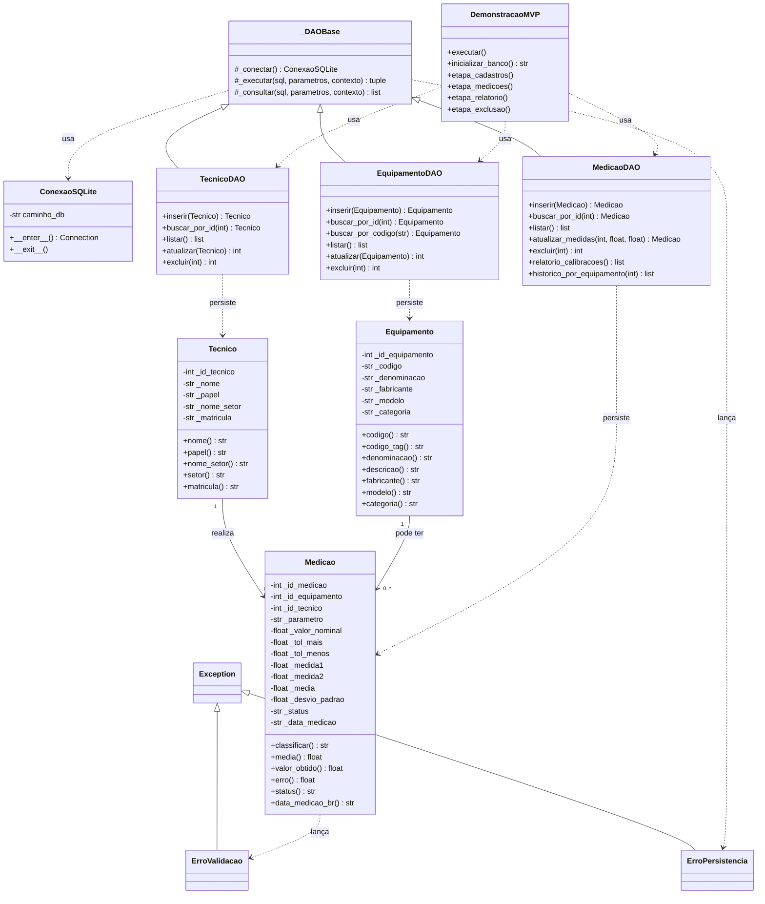

# 06 — Documentação Técnica do MVP (Parte 1)

**Unidade Curricular:** Projeto Aplicado I
**Empresa parceira:** Schulz S.A.
**Docentes:** Prof. MSc. Hugo Menezes Barra | Prof. Rodrigo Losina
**Equipe:** Marx Braga Camilo, Gladson Goulart, Carla Tayna, Yorman Hernandez
**Entrega:** AV03 — Construção do MVP (Parte 1)
**Data:** 03 de novembro de 2026

---

## Sumário

1. Apresentação
2. Arquitetura da solução (camadas, repositório, UML e padrões de POO)
3. Classes de domínio
4. Camada de persistência
5. Regras de negócio e validação metrológica
6. Classe principal e demonstração funcional
7. Tratamento de erros
8. Decisões de projeto e aderência ao roteiro
9. Limitações e trabalhos futuros
10. Conclusão

---

## 1. Apresentação

Este documento descreve a implementação da Parte 1 do MVP do sistema de gestão de calibrações da Schulz S.A., desenvolvida em **Programação Orientada a Objetos com Python** e conectada ao banco de dados relacional **SQLite**.

A entrega dá continuidade direta às etapas anteriores. A AV01 levantou o processo manual de emissão de certificados de calibração, seus requisitos funcionais e suas regras de negócio. A AV02 modelou o banco relacional em três tabelas — `tecnico`, `equipamento` e `medicao` — e entregou o script DDL `03_banco.sql`, já validado no SQLite.

Esta etapa avança da modelagem para o código. O script DDL `03_banco.sql` da AV02 foi **reaproveitado sem alteração no arquivo**, garantindo continuidade entre as entregas e preservando as restrições de integridade já validadas. A única evolução do esquema — a coluna `matricula` na tabela `tecnico` — é aplicada por uma migração em código, sem editar o DDL aprovado (seção 8.2). Sobre essa base foram acrescentados:

| Arquivo            | Conteúdo                                                     |
| ------------------ | ------------------------------------------------------------ |
| `04_classes.py`    | Classes de domínio (`Tecnico`, `Equipamento`, `Medicao`), classe de conexão (`ConexaoSQLite`), objetos de acesso a dados (DAOs) e exceções |
| `05_main.py`       | Classe principal de demonstração: instanciação, INSERT, UPDATE, DELETE, SELECT com JOIN e relatório no terminal |
| `06_mvp_parte1.md` | Este documento                                               |

---

## 2. Arquitetura da solução

### 2.1 Camadas e responsabilidades

O projeto foi organizado em três camadas com responsabilidades delimitadas, atendendo simultaneamente ao requisito de **encapsulamento** e ao requisito de **separação de responsabilidades** previstos no roteiro.

**Camada de domínio** — classes `Tecnico`, `Equipamento` e `Medicao`. Concentram os atributos, as validações e as regras de negócio metrológicas. Todos os atributos são privados (prefixo `_`) e acessados por propriedades (`@property`). Os campos que podem mudar têm *setter* que repete a validação; os identificadores só podem ser definidos uma vez, logo após o INSERT; e os campos calculados (`media`, `desvio_padrao`, `erro`, `status`) não têm *setter*. A validação ocorre no construtor, de modo que um objeto nunca existe em estado inválido.

**Camada de persistência** — classe `ConexaoSQLite` e as classes `TecnicoDAO`, `EquipamentoDAO` e `MedicaoDAO`. Concentram exclusivamente o acesso ao SQLite: abertura e fechamento de conexão, comandos SQL e tradução de erros.

**Camada de apresentação** — classe principal `DemonstracaoMVP`, em `05_main.py`. Orquestra os objetos, executa as operações e formata o relatório de calibração no terminal.

### 2.2 Estrutura do repositório

```text
Projeto_Aplicado_I_Schulz/
├── 03_banco.sql          # DDL das tabelas (AV02 — reaproveitado)
├── 04_classes.py         # Domínio + conexão + DAOs (AV03)
├── 05_main.py            # Classe principal de demonstração (AV03)
├── 06_mvp_parte1.md      # Este documento (AV03)
├── README.md             # Instruções de execução
└── .gitignore            # Ignora o arquivo .db gerado
```

O arquivo `schulz_calibracao.db` não é versionado (consta no `.gitignore`): ele é gerado automaticamente a cada execução do `05_main.py`, a partir do `03_banco.sql`.

### 2.3 Diagrama de classes



**Versão textual das relações** (para leitura sem renderizador de Mermaid):

```text
Tecnico      1 ──── 0..*  Medicao  0..* ──── 1  Equipamento
_DAOBase  <|──  TecnicoDAO | EquipamentoDAO | MedicaoDAO     (herança)
_DAOBase  ···>  ConexaoSQLite                                 (usa)
Exception <|──  ErroValidacao | ErroPersistencia              (herança)
DemonstracaoMVP ···> TecnicoDAO, EquipamentoDAO, MedicaoDAO   (usa)
```

### 2.4 Padrões de Programação Orientada a Objetos aplicados

| Padrão / conceito              | Como foi aplicado                                            | Onde                                |
| ------------------------------ | ------------------------------------------------------------ | ----------------------------------- |
| **Encapsulamento**             | Atributos privados por convenção (`_nome`) acessados por `@property`. Alterações só por *setters* que revalidam o valor. Campos derivados (`media`, `desvio_padrao`, `erro`, `status`) não têm *setter*. | Classes de domínio                  |
| **Abstração**                  | Cada classe modela um conceito do laboratório (profissional, instrumento, ensaio) e expõe apenas o que o restante do sistema precisa. | `Tecnico`, `Equipamento`, `Medicao` |
| **Herança**                    | `TecnicoDAO`, `EquipamentoDAO` e `MedicaoDAO` herdam de `_DAOBase`, que concentra conexão, execução de SQL e tradução de erros. `ErroValidacao` e `ErroPersistencia` herdam de `Exception`. | Persistência e exceções             |
| **Composição / associação**    | Os DAOs utilizam `ConexaoSQLite`. `Medicao` referencia `Equipamento` e `Tecnico` pelos identificadores (chaves estrangeiras). | DAOs e `Medicao`                    |
| **Polimorfismo (duck typing)** | Os três DAOs expõem a mesma interface (`inserir`, `buscar_por_id`, `listar`, `atualizar`, `excluir`), usada de forma uniforme pela classe principal. | DAOs                                |
| **Padrão DAO**                 | O SQL fica isolado em objetos de acesso a dados; as classes de domínio não executam comandos. | Camada de persistência              |
| **Gerenciador de contexto**    | `ConexaoSQLite` implementa `__enter__` e `__exit__`: commit em caso de sucesso, rollback em exceção, fechamento garantido. | `ConexaoSQLite`                     |
| **Exceções customizadas**      | Duas famílias distinguem falha de regra de negócio (`ErroValidacao`) de falha de banco (`ErroPersistencia`). | Seção 7                             |
| **Métodos estáticos**          | Validações e conversões que não dependem do estado do objeto (`_validar_papel`, `_validar_medida`, `_validar_data`, `_linha_para_objeto`, `_erro`). | Domínio e DAOs                      |
| **Representação textual**      | `__repr__` em todas as entidades, usado na demonstração.     | Domínio                             |
| **Tipagem**                    | Anotações de tipo (`Optional`, `list[...]`) nas assinaturas. | Todo o módulo                       |

Exemplo de encapsulamento com revalidação (`Tecnico`):

```python
@property
def nome(self) -> str:
    return self._nome

@nome.setter
def nome(self, valor):
    self._nome = _texto_obrigatorio(valor, "nome")   # revalida a cada alteração
```

---

## 3. Classes de domínio

### 3.1 Classe `Tecnico`

Representa a tabela `tecnico`, que armazena tanto os metrologistas executantes quanto os solicitantes (clientes internos dos trinta setores da Schulz). O atributo `papel` é validado contra a restrição `CHECK` do banco, aceitando apenas `TECNICO` ou `SOLICITANTE`.

| Atributo      | Tipo | Persistido                                     | Regra de validação                                         |
| ------------- | ---- | ---------------------------------------------- | ---------------------------------------------------------- |
| `_id_tecnico` | int  | Sim (PK AUTOINCREMENT)                         | Definido apenas após o INSERT; não pode ser reatribuído    |
| `_nome`       | str  | Sim (NOT NULL)                                 | Obrigatório, sem espaços nas extremidades                  |
| `_papel`      | str  | Sim (CHECK)                                    | Convertido para maiúsculas e validado contra lista fechada |
| `_nome_setor` | str  | Sim (NOT NULL)                                 | Obrigatório; exposto também pela propriedade `setor`       |
| `_matricula`  | str  | Sim (coluna adicionada por migração, `UNIQUE`) | Opcional; vazio vira `NULL` (ver seção 8.2)                |

### 3.2 Classe `Equipamento`

Representa a tabela `equipamento`, com os dispositivos de controle submetidos à calibração. O campo `categoria` é o único que aceita valor nulo, refletindo exatamente a definição da coluna no DDL.

| Atributo          | Tipo | Persistido             | Regra de validação                            |
| ----------------- | ---- | ---------------------- | --------------------------------------------- |
| `_id_equipamento` | int  | Sim (PK AUTOINCREMENT) | Definido após o INSERT                        |
| `_codigo`         | str  | Sim (NOT NULL UNIQUE)  | Obrigatório; unicidade garantida pelo banco   |
| `_denominacao`    | str  | Sim (NOT NULL)         | Obrigatório; exposto também por `descricao`   |
| `_fabricante`     | str  | Sim (NOT NULL)         | Obrigatório                                   |
| `_modelo`         | str  | Sim (NOT NULL)         | Obrigatório                                   |
| `_categoria`      | str  | Sim (nullable)         | Opcional; armazenado como NULL quando ausente |

### 3.3 Classe `Medicao`

É a classe central do MVP, pois concentra a regra metrológica de classificação do ensaio. Recebe as duas leituras, o valor nominal e as duas tolerâncias, e deriva internamente a média, o desvio padrão e o status (além do erro de medição, calculado a partir da média). **Nenhum desses campos pode ser informado externamente** — são sempre calculados, o que impede divergência entre o valor gravado e o valor calculado.

| Atributo          | Origem                     | Persistido             | Observação                                      |
| ----------------- | -------------------------- | ---------------------- | ----------------------------------------------- |
| `_id_medicao`     | Gerado pelo banco          | Sim (PK)               | Atribuído após o INSERT                         |
| `_id_equipamento` | Informado                  | Sim (FK NOT NULL)      | Vincula ao dispositivo avaliado                 |
| `_id_tecnico`     | Informado                  | Sim (FK NOT NULL)      | Vincula ao responsável pelo ensaio              |
| `_data_medicao`   | Informado ou data corrente | Sim (NOT NULL DEFAULT) | Armazenada em ISO `AAAA-MM-DD`                  |
| `_parametro`      | Informado                  | Sim (NOT NULL)         | Variável aferida                                |
| `_valor_nominal`  | Informado                  | Sim (NOT NULL)         | Valor de referência esperado                    |
| `_tol_mais`       | Informado                  | Sim (NOT NULL)         | Normalizada em valor absoluto                   |
| `_tol_menos`      | Informado                  | Sim (NOT NULL)         | Normalizada em valor absoluto                   |
| `_medida1`        | Informado                  | Sim (NOT NULL)         | Primeira leitura; obrigatória e finita          |
| `_medida2`        | Informado                  | Sim (NOT NULL)         | Segunda leitura; obrigatória e finita           |
| `_media`          | **Calculado**              | Sim (nullable no DDL)  | Média aritmética; sempre preenchida pela classe |
| `_desvio_padrao`  | **Calculado**              | Sim (nullable no DDL)  | Desvio padrão amostral; sempre preenchido       |
| `_status`         | **Calculado**              | Sim (NOT NULL CHECK)   | Derivado da comparação média × tolerâncias      |
| `erro`            | **Calculado**              | Não (propriedade)      | `media − valor_nominal` (RN07)                  |

---

## 4. Camada de persistência

### 4.1 Classe `ConexaoSQLite`

Encapsula a abertura e o fechamento da conexão com o arquivo `schulz_calibracao.db`. Foi implementada como **gerenciador de contexto**: o bloco de uso abre a conexão, e o encerramento confirma a transação em caso de sucesso ou executa rollback em caso de exceção, garantindo que nenhuma operação parcial seja persistida.

Um ponto é crítico: o comando `PRAGMA foreign_keys = ON` é executado em **toda abertura de conexão**, porque o SQLite só verifica as chaves estrangeiras com essa opção ativa. Sem ele, uma medição poderia ser gravada referenciando um equipamento inexistente.

```python
class ConexaoSQLite:
    def __init__(self, caminho_db: str = "schulz_calibracao.db"):
        self.caminho_db = caminho_db
        self._conn: Optional[sqlite3.Connection] = None

    def __enter__(self) -> sqlite3.Connection:
        try:
            self._conn = sqlite3.connect(self.caminho_db)
            self._conn.execute("PRAGMA foreign_keys = ON;")
            self._conn.row_factory = sqlite3.Row
        except sqlite3.Error as exc:
            if self._conn is not None:
                self._conn.close()
            raise ErroPersistencia(
                f"Não foi possível abrir o banco '{self.caminho_db}': {exc}"
            ) from exc
        return self._conn

    def __exit__(self, tipo_exc, valor_exc, traceback):
        try:
            if tipo_exc is None:
                self._conn.commit()
            else:
                self._conn.rollback()
        except sqlite3.Error as exc:
            raise ErroPersistencia(f"Falha ao finalizar a transação: {exc}") from exc
        finally:
            self._conn.close()
        return False  # não suprime a exceção
```

### 4.2 Objetos de acesso a dados (DAO)

Cada entidade possui um objeto de acesso a dados próprio, derivado de uma classe base que concentra a lógica de conexão e a tradução de erros do SQLite. Os comandos SQL utilizam **sempre parâmetros vinculados** com marcadores de interrogação, nunca concatenação de strings. Essa escolha elimina a possibilidade de injeção de SQL e evita erros de sintaxe causados por aspas em nomes de equipamentos.

```python
class _DAOBase:
    def _executar(self, sql: str, parametros: tuple, contexto: str) -> tuple[int, int]:
        """INSERT/UPDATE/DELETE. Retorna (lastrowid, rowcount)."""
        try:
            with self._conectar() as conn:
                cur = conn.execute(sql, parametros)
                return cur.lastrowid, cur.rowcount
        except sqlite3.Error as exc:
            raise self._erro(exc, contexto) from exc


class MedicaoDAO(_DAOBase):

    def inserir(self, medicao: Medicao) -> Medicao:
        sql = (
            "INSERT INTO medicao (id_equipamento, id_tecnico, data_medicao, "
            "parametro, valor_nominal, tol_mais, tol_menos, medida1, medida2, "
            "media, desvio_padrao, status) "
            "VALUES (?, ?, ?, ?, ?, ?, ?, ?, ?, ?, ?, ?);"
        )
        novo_id, _ = self._executar(sql, (
            medicao.id_equipamento, medicao.id_tecnico, medicao.data_medicao,
            medicao.parametro, medicao.valor_nominal, medicao.tol_mais,
            medicao.tol_menos, medicao.medida1, medicao.medida2,
            medicao.media, medicao.desvio_padrao, medicao.status,
        ), "INSERT medicao")
        medicao.id_medicao = novo_id
        return medicao
```

Os métodos de escrita (INSERT, UPDATE e DELETE) passam por `_executar()` e os de leitura (SELECT) por `_consultar()`, ambos na classe base; assim, a tradução de erros fica num único lugar. Após o INSERT, o identificador gerado pelo `AUTOINCREMENT` é recuperado por `cursor.lastrowid` e atribuído ao objeto. Assim, o objeto Python e o registro no banco permanecem sincronizados, o que permite a sequência de operações da demonstração sem consultas adicionais.

Operações CRUD disponíveis em cada DAO:

| Operação   | `TecnicoDAO`              | `EquipamentoDAO`                               | `MedicaoDAO`                                                 |
| ---------- | ------------------------- | ---------------------------------------------- | ------------------------------------------------------------ |
| **INSERT** | `inserir`                 | `inserir`                                      | `inserir`                                                    |
| **SELECT** | `buscar_por_id`, `listar` | `buscar_por_id`, `buscar_por_codigo`, `listar` | `buscar_por_id`, `listar`, `relatorio_calibracoes`, `historico_por_equipamento` |
| **UPDATE** | `atualizar`               | `atualizar`                                    | `atualizar_medidas` (recalcula média, desvio e status)       |
| **DELETE** | `excluir`                 | `excluir`                                      | `excluir`                                                    |

### 4.3 Consultas relacionais com JOIN

O relatório de calibração é produzido por uma consulta que reúne as três tabelas por meio de junções internas. A tabela de medições é o centro da consulta; as tabelas de equipamento e de técnico fornecem os dados descritivos.

```sql
SELECT
    m.id_medicao,
    e.codigo             AS codigo,
    e.denominacao        AS denominacao,
    t.nome               AS tecnico,
    t.nome_setor         AS setor,
    m.parametro          AS parametro,
    m.valor_nominal      AS valor_nominal,
    m.tol_mais           AS tol_mais,
    m.tol_menos          AS tol_menos,
    m.medida1            AS medida1,
    m.medida2            AS medida2,
    m.media              AS media,
    m.desvio_padrao      AS desvio_padrao,
    m.status             AS status,
    m.data_medicao       AS data_medicao
FROM medicao AS m
INNER JOIN equipamento AS e ON e.id_equipamento = m.id_equipamento
INNER JOIN tecnico     AS t ON t.id_tecnico     = m.id_tecnico
ORDER BY m.data_medicao DESC, e.codigo, m.id_medicao;
```

Além do relatório geral, foi implementada uma consulta de histórico por equipamento, que atende antecipadamente aos requisitos **RF07** e **RF12** levantados na AV01, relativos ao histórico consultável e à exportação de dados para auditoria.

---

## 5. Regras de negócio e validação metrológica

### 5.1 Classificação do ensaio

A regra deriva diretamente do dicionário de dados da AV02: a medição é aprovada quando a média das duas leituras está contida no intervalo fechado delimitado pelas tolerâncias.

```python
def _dec(valor: float) -> Decimal:
    """Converte float em Decimal (6 casas) para comparações sem ruído binário."""
    return Decimal(str(round(valor, 6)))

def classificar(self) -> str:
    limite_inferior = _dec(self._valor_nominal) - _dec(self._tol_menos)
    limite_superior = _dec(self._valor_nominal) + _dec(self._tol_mais)
    return (
        "APROVADO"
        if limite_inferior <= _dec(self._media) <= limite_superior
        else "REPROVADO"
    )
```

A comparação é **inclusiva nos dois extremos**: uma leitura exatamente igual ao limite superior é classificada como `APROVADO`. Esse comportamento é validado por um caso de teste específico (seção 6.2).

A comparação é feita com `Decimal`, e não diretamente com `float`, porque a aritmética binária de ponto flutuante acumula ruído. Por exemplo, a média das leituras 100,04 e 100,06 resulta em `100.05000000000001`, valor que excede o limite superior `100.0 + 0.05 = 100.05`; uma média que deveria estar exatamente no limite seria reprovada. Arredondar para 6 casas e converter para `Decimal` garante que o valor no limite seja tratado como igual ao limite.

### 5.2 Normalização do sinal das tolerâncias

Durante o levantamento da AV01 verificou-se que a tolerância inferior pode aparecer nas planilhas de origem como valor negativo, zero ou positivo, dependendo do instrumento e da forma de preenchimento. Para eliminar essa ambiguidade, a classe `Medicao` armazena as duas tolerâncias em **valor absoluto** e aplica o sinal correto na fórmula. A convenção adotada é: `tol_mais` é sempre somada ao valor nominal e `tol_menos` é sempre subtraída.

### 5.3 Campos derivados e a restrição CHECK do banco

Este é o ponto de maior criticidade técnica da integração entre código e banco. A coluna `status` é declarada como `NOT NULL` com `CHECK` limitada aos valores `APROVADO` e `REPROVADO`. Isso significa que o banco **rejeita** qualquer inserção com status nulo ou fora da lista.

Por esse motivo, a classificação é executada **dentro do construtor** da classe `Medicao`, antes de qualquer comando SQL. O status chega ao INSERT já calculado e válido.

O mesmo raciocínio se aplica a `media` e `desvio_padrao`, que são anuláveis no DDL mas tratadas como obrigatórias na camada de domínio. Como são calculadas no construtor, a aplicação nunca grava esses campos nulos, ainda que o banco o permitisse.

### 5.4 Desvio padrão adotado

Com duas leituras, o desvio padrão pode ser calculado por duas convenções: a **amostral** (divisor n−1) e a **populacional** (divisor n). A solução adotada é a amostral, por ser a convenção das fórmulas da planilha manual descrita na AV01 e por preservar a comparabilidade com os certificados históricos da Schulz.

Com duas medidas `a` e `b`, o desvio amostral equivale a `s = |a − b| / √2`.

A escolha está registrada de forma explícita no código (`statistics.stdev`), para que não haja divergência futura.

### 5.5 Rastreabilidade entre regras de negócio e código

| Regra de negócio                                             | Origem          | Implementação em `04_classes.py`                             |
| ------------------------------------------------------------ | --------------- | ------------------------------------------------------------ |
| Calibração só é concluída com `medida1` e `medida2` preenchidas com valores numéricos | RN01            | `_validar_medida()` na classe `Medicao`; rejeita vazio, espaço, texto não numérico, `nan` e `inf` |
| O erro de cada parâmetro é calculado como diferença entre valor obtido e valor nominal | RN07            | Propriedade `erro` (média − nominal), sem *setter*; não pode ser digitado manualmente |
| Medições fora da faixa de tolerância devem ser sinalizadas como reprovadas | RN08            | `classificar()`, executado no construtor                     |
| Nenhum texto com datas pode ser gerado por concatenação de texto livre | RN09            | Propriedade `data_medicao_br`, que formata a partir de objeto de data real |
| Datas recebidas como placeholder (`00/00/0000`, `???`) são rejeitadas | Regra de ETL 26 | `_validar_data()` na classe `Medicao`                        |

As regras RN03 (tipos de medição sem duplicidade de grafia) e RN06 (dispositivo vinculado a um setor cliente) não fazem parte deste MVP, porque dependem de tabelas ainda não modeladas (`TipoMedicao` e `SetorCliente`). Elas estão previstas para as próximas etapas (seção 9).

A regra RN09 merece destaque porque corrige um defeito real identificado na AV01. No certificado nº 00091/2026, o texto que descreve o padrão utilizado era montado por concatenação e exibia o nome do dia da semana — `Wednesday` e `Monday` — no lugar das datas. A propriedade `data_medicao_br` elimina essa classe de defeito: recebe a data em ISO, converte para objeto de data e só então formata no padrão brasileiro. **Não existe caminho no código que produza uma data por concatenação de texto.**

---

## 6. Classe principal e demonstração funcional

O script `05_main.py` executa o fluxo funcional completo em nove etapas sequenciais, orquestradas pela classe `DemonstracaoMVP`:

1. Inicialização do banco a partir do `03_banco.sql`
2. Instanciação e INSERT de técnicos e equipamentos, com SELECT por id
3. INSERT de três medições com classificação automática
4. Bloqueio de medição incompleta (RN01)
5. Rejeição de chave estrangeira inexistente
6. UPDATE das leituras com recálculo automático
7. Relatório com JOIN triplo
8. Histórico por equipamento (RF07)
9. DELETE e proteção por chave estrangeira

### 6.1 Inicialização do banco

A rotina verifica se o `03_banco.sql` existe, apaga o arquivo `schulz_calibracao.db` anterior e executa o script integralmente, recriando o banco do zero. Em seguida, `garantir_coluna_matricula()` aplica a migração da coluna `matricula`. Recriar o banco a cada execução torna a demonstração reproduzível: os identificadores e os resultados são sempre os mesmos. Dessa forma, o `03_banco.sql` da AV02 permanece como **base da estrutura do banco**, complementada apenas pela migração da coluna `matricula`.

> **Atenção:** como a demonstração apaga o `.db` a cada execução, ela não deve ser executada sobre um banco com dados reais (seção 9).

### 6.2 Casos de teste: esperado × obtido

| Caso                                 | Dados de entrada                                         | Resultado esperado                           | Regra validada                  | Resultado obtido                           |
| ------------------------------------ | -------------------------------------------------------- | -------------------------------------------- | ------------------------------- | ------------------------------------------ |
| Medição dentro da faixa              | Média 50,025; nominal 50,000; tolerâncias ±0,050         | `APROVADO`                                   | Classificação nominal           | `APROVADO` (erro +0,025)                   |
| Medição acima do limite superior     | Média 50,095; nominal 50,000; tolerâncias ±0,050         | `REPROVADO`                                  | Limite superior excedido        | `REPROVADO` (erro +0,095)                  |
| Medição exatamente no limite         | Média 25,050; nominal 25,000; tolerância superior 0,050  | `APROVADO`                                   | Comparação inclusiva no extremo | `APROVADO`                                 |
| Medição com leitura vazia            | `medida1` preenchida, `medida2` com apenas espaço        | Bloqueio antes do INSERT                     | RN01                            | `ErroValidacao`                            |
| Medição com equipamento inexistente  | `id_equipamento = 9999`                                  | Rejeição por `FOREIGN KEY constraint failed` | Integridade referencial         | `ErroPersistencia` (FK)                    |
| Atualização de leitura reprovada     | Medição 2 recebe leituras 50,010 e 50,020 (média 50,015) | Recálculo automático → `APROVADO`            | RF02 e RN07                     | `REPROVADO` (50,095) → `APROVADO` (50,015) |
| Matrícula persistida                 | Técnico com matrícula `MT-0042`                          | SELECT por id devolve a matrícula            | Persistência da `matricula`     | `MT-0042`                                  |
| Histórico do paquímetro              | Consulta por `id_equipamento` do 703.1208                | Lista as duas medições do equipamento        | RF07                            | Duas medições listadas                     |
| Exclusão de equipamento com medições | DELETE do paquímetro 703.1208                            | Rejeição por `FOREIGN KEY constraint failed` | Preservação do histórico        | `ErroPersistencia` (FK)                    |
| Exclusão de medição                  | DELETE da medição 3                                      | 1 linha removida; restam 2 medições          | CRUD (DELETE)                   | 1 linha removida; 2 restantes              |

### 6.3 Saída real do terminal

A consulta relacional alimenta um relatório formatado com colunas alinhadas. O rodapé consolida total de medições, aprovadas, reprovadas e taxa de aprovação. As datas são exibidas no padrão brasileiro, sempre convertidas a partir do valor ISO armazenado.

Como o relatório (etapa 7) é gerado depois do UPDATE da etapa 6, a medição 2 já aparece com as leituras corrigidas e status `APROVADO`; a reprovação original está registrada na saída das etapas 3 e 6. A data é a do dia da execução (02/11/2026).

Saída completa de `python 05_main.py`:

```text
[1] Inicialização do banco: banco recriado a partir do 03_banco.sql (coluna 'matricula' adicionada por migração)

[2] Instanciando objetos de domínio e inserindo (INSERT)
    Tecnico(id=1, nome='José A. Rosa Jr.', matricula='MT-0042', papel='TECNICO', setor='Metrologia')
    Tecnico(id=2, nome='Cleocir de Souza', matricula=None, papel='SOLICITANTE', setor='Usinagem I')
    Equipamento(id=1, codigo='703.1208', denominacao='Paquímetro digital')
    Equipamento(id=2, codigo='703.2210', denominacao='Relógio comparador')
    SELECT por id -> matrícula gravada no banco: MT-0042

[3] Registrando medições (INSERT com classificação automática)
    id=1 | 703.1208 | média=50.025 | erro=+0.025 | desvio=0.0071 | status=APROVADO (dentro da faixa)
    id=2 | 703.1208 | média=50.095 | erro=+0.095 | desvio=0.0071 | status=REPROVADO (acima do limite superior)
    id=3 | 703.2210 | média=25.050 | erro=+0.050 | desvio=0.0000 | status=APROVADO (exatamente no limite superior)

[4] Testando bloqueio de medição incompleta (RN01)
    Bloqueado corretamente: Medição pendente: 'medida2' é obrigatória e não pode ser vazia.

[5] Testando rejeição de FK inexistente (PRAGMA foreign_keys = ON)
    Rejeitado pelo banco: Erro SQL em INSERT medicao: FOREIGN KEY constraint failed

[6] Atualizando as leituras da medição reprovada (UPDATE)
    id=2 | antes: REPROVADO (média 50.095) -> depois: APROVADO (média 50.015)

[7] Consulta relacional com JOIN

====================================================================================================================================
RELATÓRIO DE CALIBRAÇÃO — SCHULZ S.A. / LABORATÓRIO DE METROLOGIA
====================================================================================================================================
  ID CÓDIGO      EQUIPAMENTO          TÉCNICO          SETOR          NOMINAL  TOL(±)     MED1     MED2    MÉDIA  DESVIO STATUS     DATA
------------------------------------------------------------------------------------------------------------------------------------
   1 703.1208    Paquímetro digital   José A. Rosa Jr. Metrologia      50.000   0.050   50.020   50.030   50.025  0.0071 APROVADO   02/11/2026
   2 703.1208    Paquímetro digital   José A. Rosa Jr. Metrologia      50.000   0.050   50.010   50.020   50.015  0.0071 APROVADO   02/11/2026
   3 703.2210    Relógio comparador   José A. Rosa Jr. Metrologia      25.000   0.050   25.050   25.050   25.050  0.0000 APROVADO   02/11/2026
------------------------------------------------------------------------------------------------------------------------------------
Total de medições: 3   |   Aprovadas: 3   |   Reprovadas: 0   |   Taxa de aprovação: 100.0%
====================================================================================================================================

[8] Histórico do paquímetro 703.1208 (RF07)
    02/11/2026 | Comprimento  | média=50.025 | APROVADO
    02/11/2026 | Comprimento  | média=50.015 | APROVADO

[9] Testando exclusão (DELETE)
    Equipamento com medições não pode ser excluído: Erro SQL em DELETE equipamento: FOREIGN KEY constraint failed
    Medição id=3 excluída (1 linha). Medições restantes: 2
```

Os dados utilizados foram extraídos do levantamento da AV01 e do dicionário da AV02, incluindo o código real do paquímetro `703.1208`, o fabricante Mitutoyo e os nomes dos metrologistas e setores citados no diagnóstico do processo manual.

---

## 7. Tratamento de erros

O tratamento foi estruturado em duas famílias de exceções de domínio, ambas herdadas de `Exception`, o que permite distinguir falhas de regra de negócio de falhas de persistência.

| Exceção            | Origem       | Situações tratadas                                           | Comportamento                                                |
| ------------------ | ------------ | ------------------------------------------------------------ | ------------------------------------------------------------ |
| `ErroValidacao`    | Domínio      | Campo de texto vazio; papel fora da lista; medida ausente, vazia, não numérica, `nan` ou `inf`; identificador inválido (por exemplo `None`); data inválida ou placeholder; identificador já definido sendo reatribuído; atualização sem identificador ou de registro inexistente | Interrompe a operação antes de qualquer comando SQL          |
| `ErroPersistencia` | Persistência | Falha ao abrir o banco; falha no commit; violação de chave estrangeira (INSERT e DELETE); violação de `UNIQUE`; violação do `CHECK` de status; tabela inexistente; UPDATE sem linha afetada; DDL não encontrado | Rollback da transação e mensagem contextualizada com a operação que falhou |

Toda comunicação com o banco é envolvida em blocos de captura de exceção do SQLite, tanto nas escritas quanto nas leituras. Como `sqlite3.Error` é a superclasse de `IntegrityError`, `OperationalError` e demais erros do módulo, nenhuma exceção bruta do SQLite chega à camada de apresentação. As falhas são traduzidas para `ErroPersistencia` com o nome da operação que falhou — por exemplo `INSERT medicao`, `DELETE equipamento` ou `SELECT relatorio (JOIN)` — o que torna o diagnóstico imediato.

```python
@staticmethod
def _erro(exc: sqlite3.Error, contexto: str) -> ErroPersistencia:
    return ErroPersistencia(f"Erro SQL em {contexto}: {exc}")

# uso (em _executar e _consultar)
try:
    with self._conectar() as conn:
        cur = conn.execute(sql, parametros)
        return cur.lastrowid, cur.rowcount
except sqlite3.Error as exc:
    raise self._erro(exc, contexto) from exc
```

O gerenciador de contexto assegura que qualquer exceção não tratada provoque rollback automático, evitando registros parciais. Na classe principal, `main()` captura as duas exceções e encerra com mensagem legível, sem exibir traceback.

---

## 8. Decisões de projeto e aderência ao roteiro

As decisões a seguir merecem registro explícito, porque conciliam a redação do roteiro da AV03 com o modelo de dados já validado na AV02. Em todos os casos, a prioridade foi **preservar o banco aprovado** e resolver as diferenças de nomenclatura na camada de classes.

### 8.1 Propriedades de compatibilidade de nomenclatura

O roteiro da AV03 cita nomes de campo diferentes dos utilizados no DDL da AV02. Como o banco foi validado e aprovado, a solução foi manter a nomenclatura do banco e expor propriedades com os nomes citados no roteiro.

| Nome no roteiro AV03                           | Coluna no DDL AV02                  | Propriedade na classe    | Estratégia                                         |
| ---------------------------------------------- | ----------------------------------- | ------------------------ | -------------------------------------------------- |
| `codigo_tag`                                   | `codigo`                            | `codigo_tag`             | Propriedade somente leitura                        |
| `descricao`                                    | `denominacao`                       | `descricao`              | Propriedade somente leitura                        |
| `setor`                                        | `nome_setor`                        | `setor`                  | Propriedade somente leitura                        |
| valor obtido                                   | `media`                             | `valor_obtido`           | Propriedade somente leitura                        |
| `matricula`                                    | Não existe no DDL                   | `matricula`              | Coluna adicionada por migração em código (ver 8.2) |
| tabelas `tecnicos`, `equipamentos`, `medicoes` | `tecnico`, `equipamento`, `medicao` | —                        | Mantido o singular do DDL aprovado na AV02         |
| tolerâncias                                    | `tol_mais` e `tol_menos`            | `tol_mais` e `tol_menos` | Já representadas por duas colunas explícitas       |

### 8.2 Campo `matricula`

O roteiro cita `matricula` na classe `Tecnico`, mas o DDL aprovado na AV02 não possui essa coluna. Para não editar o script aprovado, a coluna é criada por uma **migração em código**: a função `garantir_coluna_matricula()` consulta `PRAGMA table_info(tecnico)` e, se a coluna não existir, executa `ALTER TABLE tecnico ADD COLUMN matricula TEXT`. Em seguida cria o índice único `ux_tecnico_matricula`, que impede matrículas repetidas e aceita técnicos sem matrícula (`NULL`), como os solicitantes. A migração é idempotente: rodá-la de novo não altera nada. A etapa 2 da demonstração comprova a persistência com um SELECT por id que devolve a matrícula `MT-0042` gravada no banco.

Uma alternativa equivalente, a ser adotada em versão futura do esquema, é declarar `matricula TEXT UNIQUE` diretamente no `03_banco.sql`; a migração passaria a funcionar apenas como salvaguarda.

### 8.3 Isolamento do SQL em objetos de acesso a dados

O roteiro pede métodos CRUD para comunicação com o SQLite e, simultaneamente, exige separação de responsabilidades. Manter os comandos SQL dentro das classes de domínio atenderia ao primeiro requisito e violaria o segundo.

A solução separa as responsabilidades: as classes de domínio validam e calculam; as classes DAO executam o SQL. Os quatro grupos de operação — inserção, consulta, atualização e exclusão — estão implementados nos três DAOs (seção 4.2), e os principais são exercitados na demonstração: INSERT das três entidades, SELECT por id e por JOIN, UPDATE de medições e DELETE de medição e de equipamento. A separação de camadas preserva a qualidade arquitetural pedida.

### 8.4 Nomenclatura do arquivo e o import

O roteiro exige o nome `04_classes.py`, mas Python não permite `import` de módulo cujo nome começa com número. A solução adotada foi manter o nome exigido e carregar o arquivo dinamicamente em `05_main.py`, com o caminho resolvido a partir da pasta do próprio script:

```python
import importlib.util
from pathlib import Path

PASTA = Path(__file__).resolve().parent

_spec = importlib.util.spec_from_file_location("classes_04", PASTA / "04_classes.py")
_classes = importlib.util.module_from_spec(_spec)
_spec.loader.exec_module(_classes)

Tecnico = _classes.Tecnico
Medicao = _classes.Medicao
```

Assim, o requisito de nomenclatura é atendido sem renomear o arquivo nem criar duplicatas, e o script funciona a partir de qualquer pasta de trabalho.

### 8.5 Aderência item a item ao roteiro

| Item requisitado                                             | Como foi atendido                                            | Evidência        |
| ------------------------------------------------------------ | ------------------------------------------------------------ | ---------------- |
| Classe `Tecnico` com `id_tecnico`, `matricula`, `nome`, `setor` | Implementada com validação de papel, propriedades de compatibilidade e `matricula` persistida | Seções 3.1 e 8.2 |
| Classe `Equipamento` com `id_equipamento`, `codigo_tag`, `descricao`, `fabricante` | Implementada com propriedades de compatibilidade e categoria opcional | Seção 3.2        |
| Classe `Medicao` com validação de status por tolerância      | Classificação no construtor e campos derivados               | Seções 3.3 e 5   |
| Classe de conexão e persistência com INSERT, SELECT e UPDATE | `ConexaoSQLite` e três DAOs com parâmetros vinculados; DELETE incluído | Seção 4          |
| Script principal com instanciação, inserção e JOIN           | `05_main.py` com nove etapas e relatório no terminal         | Seção 6          |
| Documentação técnica com padrões de POO                      | Tabela de padrões aplicados                                  | Seção 2.4        |
| Diagramação textual/UML das classes                          | Diagrama Mermaid e versão textual das relações               | Seção 2.3        |
| Tratamento de erros SQL                                      | Duas famílias de exceções, captura de `sqlite3.Error` em escritas e leituras e rollback automático | Seção 7          |
| Validação do fluxo funcional do MVP                          | Casos de teste esperado × obtido e saída real do terminal    | Seções 6.2 e 6.3 |
| Versionamento em GitHub e instruções de execução             | Link do repositório e passo a passo de execução              | Seção 10         |

---

## 9. Limitações e trabalhos futuros

| Limitação atual                                              | Evolução prevista                                            |
| ------------------------------------------------------------ | ------------------------------------------------------------ |
| RN03 (tipos de medição sem duplicidade de grafia) e RN06 (vínculo com setor cliente) não implementadas, pois dependem de tabelas ainda não modeladas | Criar as tabelas `TipoMedicao` e `SetorCliente` e as respectivas validações |
| A demonstração recria o banco a cada execução e, por isso, apaga o `.db` anterior | Separar o modo de demonstração do modo de uso real, com banco persistente |
| A coluna `matricula` depende de migração em código           | Incorporar `matricula TEXT UNIQUE` ao `03_banco.sql`         |
| O relatório exibe apenas `tol_mais` na coluna `TOL(±)`       | Mostrar as duas tolerâncias quando forem assimétricas        |
| Apenas duas leituras por ensaio e saída somente no terminal  | Cálculo de incerteza, interface de entrada de dados e exportação do relatório (RF12) |
| Nenhum DAO de `Tecnico` e `Equipamento` possui teste automatizado | Suíte de testes automatizados dos DAOs e das regras de `Medicao` |


---

## 10. Conclusão

As três entidades do domínio foram implementadas com encapsulamento por propriedades, validação de estado no construtor e nos *setters*; a regra metrológica de classificação foi encapsulada na classe `Medicao` e executada antes de qualquer comando SQL, respeitando a restrição `CHECK` do banco; e o acesso ao SQLite foi isolado em objetos de acesso a dados, com herança de uma classe base, comandos parametrizados, tradução centralizada de erros e rollback automático.

O fluxo funcional foi demonstrado de ponta a ponta, da criação do banco à emissão do relatório de calibração por meio de consulta relacional com junção das três tabelas, passando pelas quatro operações CRUD. Foram validados casos de aprovação, reprovação e comportamento na fronteira da tolerância, além dos bloqueios de regra de negócio e de integridade referencial, inclusive na exclusão de equipamento com histórico.

Ficam como pendências para as próximas etapas as regras RN03 e RN06, que dependem das tabelas de tipos de medição e de setores clientes (seção 9). O MVP constitui a base sobre a qual essas etapas acrescentarão o cálculo de incerteza, a importação automática do relatório da máquina de medição por coordenadas e a emissão do certificado de calibração, concluindo a substituição do processo manual hoje baseado em planilhas independentes.
